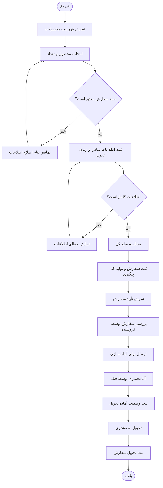

# جلسه سوم: مدل‌سازی نیازمندی‌ها و UML
**موضوع درسی:** Requirements Modeling and UML  
**فصل مرتبط:** فصل ۸ کتاب پرسمن و ماکسیم

## ۱. هدف جلسه
مدل‌سازی کمک می‌کند نیازمندی‌ها را به شکل تصویری و منظم نشان دهیم. در این تمرین، دو نمودار برای سامانه مدیریت سفارش‌های شیرینی‌فروشی رسم می‌کنم:
- نمودار موردکاربرد (Use Case)
- نمودار فعالیت (Activity)

## ۲. محدوده فرایند اصلی
فرایند انتخاب‌شده، ثبت سفارش تا آماده‌شدن و تحویل آن است. مشتری اقلام را انتخاب می‌کند، سفارش ثبت می‌شود، کارکنان آن را بررسی و آماده می‌کنند و در پایان تحویل ثبت می‌شود.

## ۳. نمودار موردکاربرد (Use Case Diagram)

بازیگران اصلی:
- **مشتری:** مشاهده محصولات، ثبت سفارش و پیگیری.
- **فروشنده:** ثبت سفارش مشتری و مشاهده فهرست سفارش‌ها.
- **قناد:** مشاهده جزئیات سفارش و اعلام شروع یا پایان آماده‌سازی.
- **مسئول تحویل:** ثبت تحویل سفارش.
- **مدیر:** مدیریت محصولات و کاربران.

```mermaid
usecaseDiagram
actor Customer as "مشتری"
actor Seller as "فروشنده"
actor Baker as "قناد"
actor Delivery as "مسئول تحویل"
actor Manager as "مدیر"

rectangle "سامانه مدیریت سفارش شیرینی‌فروشی" {
  Customer --> (مشاهده محصولات)
  Customer --> (ثبت سفارش)
  Customer --> (پیگیری سفارش)

  Seller --> (ثبت سفارش مشتری)
  Seller --> (مشاهده سفارش‌ها)

  Baker --> (مشاهده سفارش‌های در انتظار)
  Baker --> (به‌روزرسانی آماده‌سازی)

  Delivery --> (مشاهده سفارش آماده)
  Delivery --> (ثبت تحویل)

  Manager --> (مدیریت محصولات)
  Manager --> (مدیریت کاربران)
  Manager --> (مشاهده گزارش سفارش‌ها)
}
```

### توضیح نمودار
مستطیل مرز سامانه را مشخص می‌کند و بازیگران بیرون آن قرار دارند. هر بیضی یک قابلیتی را نشان می‌دهد که سامانه در اختیار یک بازیگر قرار می‌دهد. برای مثال، مشتری می‌تواند سفارش را ثبت یا پیگیری کند، اما مدیریت محصولات فقط برای مدیر در نظر گرفته شده است.

## ۴. نمودار فعالیت (Activity Diagram)

نمودار زیر جریان اصلی ثبت سفارش را از انتخاب محصول تا ثبت نهایی و آماده‌سازی نشان می‌دهد. مسیرهای خطا نیز در آن در نظر گرفته شده‌اند.



## ۵. شرح گام‌های فرایند
1. سامانه محصولات فعال را نمایش می‌دهد.
2. مشتری یک یا چند محصول و تعداد آن‌ها را انتخاب می‌کند.
3. سامانه بررسی می‌کند سبد خالی نباشد و تعدادها معتبر باشند.
4. اطلاعات تماس و زمان تحویل دریافت می‌شود.
5. مبلغ کل محاسبه و سفارش ذخیره می‌شود.
6. کد پیگیری به مشتری نمایش داده می‌شود.
7. فروشنده سفارش را بررسی و برای آماده‌سازی ارسال می‌کند.
8. قناد پس از آماده‌سازی، وضعیت را به «آماده تحویل» تغییر می‌دهد.
9. پس از تحویل، مسئول مربوط وضعیت نهایی را ثبت می‌کند.

## ۶. ارتباط مدل با نیازمندی‌ها
| نیازمندی | محل نمایش در مدل |
|---|---|
| FR-01 مشاهده محصولات | موردکاربرد «مشاهده محصولات» و ابتدای نمودار فعالیت |
| FR-02 ثبت سفارش | موردکاربرد «ثبت سفارش» و گام‌های انتخاب و ثبت |
| FR-04 کد پیگیری | گام تولید کد پیگیری |
| FR-06 نمایش وضعیت | موردکاربرد «پیگیری سفارش» |
| FR-07 تغییر وضعیت | موردکاربرد قناد و گام‌های آماده‌سازی |
| FR-10 ثبت تحویل | موردکاربرد «ثبت تحویل» و انتهای نمودار فعالیت |

## ۷. نکات و فرض‌ها
- نمودار فعالیت، مسیر معمول سفارش را نشان می‌دهد و همه حالت‌های استثنایی کسب‌وکار را پوشش نمی‌دهد.
- در این مدل، پرداخت آنلاین در محدوده نسخه اولیه نیست.
- اگر سفارش تلفنی باشد، فروشنده اطلاعات را به جای مشتری وارد می‌کند.
- برای تکمیل مدل در مراحل بعد می‌توان نمودار توالی (Sequence Diagram) را نیز برای ارتباط صفحه سفارش، سرویس سفارش و پایگاه داده رسم کرد.

## ۸. جمع‌بندی
نمودار Use Case نشان می‌دهد چه کسانی از سامانه چه قابلیت‌هایی می‌خواهند. نمودار Activity ترتیب فعالیت‌ها و تصمیم‌های موجود در یک فرایند را نمایش می‌دهد. استفاده هم‌زمان از این دو مدل، درک نیازمندی‌ها را برای اعضای تیم آسان‌تر می‌کند.

## منبع
Pressman & Maxim, *Software Engineering: A Practitioner's Approach*, 9th Edition, Chapter 8: Requirements Modeling – A Recommended Approach.
