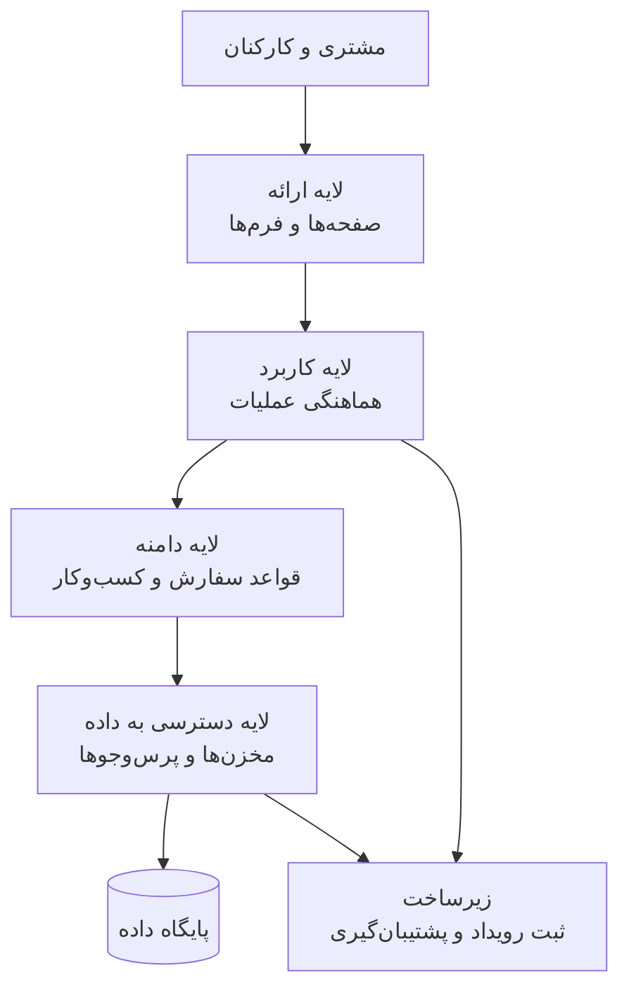

# جلسه پنجم: معماری نرم‌افزار و طراحی لایه‌ای
**موضوع درسی:** Software Architecture and Layered Design  
**فصل‌های مرتبط:** فصل ۱۰ و ۱۱ کتاب پرسمن و ماکسیم

## ۱. هدف جلسه
معماری نرم‌افزار ساختار کلی سامانه را مشخص می‌کند: بخش‌های اصلی چه هستند، چه مسئولیتی دارند و چگونه با هم ارتباط برقرار می‌کنند. برای سامانه مدیریت سفارش‌های شیرینی‌فروشی، معماری لایه‌ای انتخاب مناسبی برای نسخه آموزشی است؛ چون منطق کسب‌وکار را از رابط کاربری و ذخیره‌سازی داده جدا می‌کند.

## ۲. لایه‌های پیشنهادی

### لایه اول: ارائه (Presentation Layer)
این لایه صفحه‌ها و فرم‌هایی را در اختیار مشتری و کارکنان قرار می‌دهد.
- نمایش فهرست محصولات
- فرم ثبت سفارش
- صفحه پیگیری سفارش
- پنل سفارش‌های کارکنان

این لایه نباید مستقیماً قواعد اصلی کسب‌وکار یا دستورهای پایگاه داده را اجرا کند.

### لایه دوم: منطق کاربرد (Application Layer)
این لایه جریان انجام عملیات را مدیریت می‌کند.
- دریافت درخواست ثبت سفارش
- هماهنگ‌کردن بررسی محصول و زمان تحویل
- فراخوانی سرویس تغییر وضعیت
- آماده‌کردن اطلاعات موردنیاز صفحه‌ها

### لایه سوم: منطق کسب‌وکار (Domain Layer)
قواعد اصلی سامانه در این لایه قرار می‌گیرند.
- معتبر بودن تعداد اقلام سفارش
- محاسبه مبلغ کل
- معتبر بودن تغییر وضعیت سفارش
- بررسی قواعد زمان تحویل
- تعریف موجودیت‌هایی مانند سفارش، قلم سفارش و محصول

### لایه چهارم: دسترسی به داده (Data Access Layer)
این لایه ارتباط با پایگاه داده را مدیریت می‌کند.
- ذخیره و بازیابی سفارش
- خواندن اطلاعات محصولات
- ذخیره سابقه تغییر وضعیت
- بازیابی اطلاعات کاربران و نقش‌ها

### لایه پنجم: زیرساخت (Infrastructure)
این بخش امکانات فنی موردنیاز را فراهم می‌کند؛ مانند ثبت رویدادها، پشتیبان‌گیری، تنظیمات اتصال و سرویس‌های جانبی. بسته به فناوری انتخابی، بعضی از این امکانات می‌توانند در لایه دسترسی به داده یا سرویس‌های جدا قرار بگیرند.

## ۳. نمودار معماری لایه‌ای

در این طرح، درخواست معمول از لایه ارائه به لایه کاربرد می‌رود. قواعد اصلی در لایه دامنه قرار دارند و عملیات ذخیره‌سازی از طریق لایه دسترسی به داده انجام می‌شود. زیرساخت نیز خدمات فنی موردنیاز را فراهم می‌کند.

## ۴. رابط مؤلفه‌ها (Component Interfaces)

رابط مشخص می‌کند یک مؤلفه چه عملیاتی را در اختیار سایر بخش‌ها قرار می‌دهد و چه ورودی یا خروجی‌ای دارد. نام‌ها و امضاهای زیر نمونه پیشنهادی هستند و به زبان برنامه‌نویسی خاصی وابسته نیستند.

| مؤلفه | عملیات یا رابط | ورودی اصلی | خروجی |
|---|---|---|---|
| ProductService | getActiveProducts() | بدون ورودی | فهرست محصولات فعال |
| ProductService | updateProduct(productId, data) | شناسه و اطلاعات محصول | نتیجه عملیات |
| OrderService | createOrder(customerInfo, items, deliveryTime) | اطلاعات مشتری، اقلام و زمان تحویل | کد سفارش و نتیجه ثبت |
| OrderService | getOrderByTrackingCode(code) | کد پیگیری | اطلاعات سفارش یا نتیجه یافت‌نشدن |
| OrderStatusService | changeStatus(orderId, newStatus, actorId) | سفارش، وضعیت جدید و کاربر | وضعیت جدید یا خطای اعتبارسنجی |
| DeliveryService | confirmDelivery(orderId, staffId) | شناسه سفارش و مسئول تحویل | نتیجه ثبت تحویل |
| ReportService | getOrdersByDate(date) | تاریخ موردنظر | فهرست سفارش‌های آن روز |
| UserAccessService | hasPermission(userId, action) | کاربر و عملیات | درست یا نادرست بودن مجوز |

## ۵. نمونه قرارداد رابط ثبت سفارش

**نام عملیات:** createOrder

**ورودی‌ها:**
- اطلاعات تماس مشتری
- فهرست اقلام سفارش، شامل شناسه محصول و تعداد
- زمان پیشنهادی تحویل

**مراحل مورد انتظار:**
1. بررسی کامل‌بودن اطلاعات مشتری
2. بررسی اینکه سفارش حداقل یک قلم داشته باشد
3. بررسی مثبت‌بودن تعداد هر قلم
4. بررسی فعال‌بودن محصولات انتخاب‌شده
5. محاسبه مبلغ کل
6. ذخیره سفارش و اقلام آن
7. تولید کد پیگیری یکتا

**خروجی موفق:**
- شناسه سفارش
- کد پیگیری
- مبلغ کل
- وضعیت اولیه سفارش

**خروجی ناموفق:**
- کد یا نوع خطا
- پیام قابل فهم برای کاربر
- ثبت‌نشدن سفارش ناقص به‌عنوان سفارش موفق

## ۶. دلیل انتخاب معماری لایه‌ای
- تغییر ظاهر صفحه‌ها نباید نیازمند تغییر قواعد محاسبه مبلغ باشد.
- می‌توان منطق سفارش را جدا از پایگاه داده آزمون کرد.
- اگر نوع پایگاه داده عوض شود، تغییرات اصلی باید در لایه دسترسی به داده محدود بمانند.
- مسئولیت هر لایه روشن است و پیدا کردن محل خطا آسان‌تر می‌شود.

## ۷. محدودیت‌ها و ریسک‌های این انتخاب
- اگر مرز لایه‌ها رعایت نشود، لایه‌ها به هم وابسته می‌شوند و مزیت معماری کم می‌شود.
- برای سامانه بسیار کوچک، تعداد زیاد لایه‌ها ممکن است پیچیدگی اضافی ایجاد کند.
- عملیات باید از مسیر مشخص عبور کنند و دسترسی مستقیم رابط کاربری به پایگاه داده مجاز نیست.

## ۸. جمع‌بندی
در این پروژه معماری لایه‌ای انتخاب شد تا رابط کاربری، هماهنگی عملیات، قواعد کسب‌وکار و ذخیره‌سازی از هم جدا باشند. تعریف رابط‌های مشخص نیز باعث می‌شود مؤلفه‌ها بدون اطلاع از جزئیات داخلی یکدیگر با هم کار کنند.

## منبع
Pressman & Maxim, *Software Engineering: A Practitioner's Approach*, 9th Edition, Chapter 10: Architectural Design – A Recommended Approach؛ Chapter 11: Component-Level Design.
